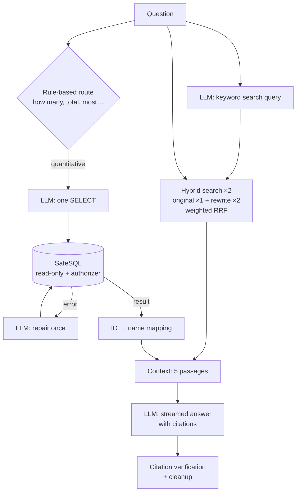

# local-enterprise-rag

**A fully local RAG assistant over company data:** hybrid search (E5 embeddings + BM25), safe text-to-SQL, and cited answers from a local LLM via [Ollama](https://ollama.com). No data leaves your machine, and no API key is needed.

It answers questions such as *"Above what amount do purchase orders require formal approval?"* from the company's documents, and questions such as *"How many projects went over budget?"* from its database. Every fact in an answer carries a source ID such as `[DOC0000056]` or `(database)`.

```
Q: Above what amount do purchase orders require formal approval?
A: Purchase orders of $10,000 or more require formal approval [DOC0000056].

Q: How many projects went over budget?
A: 8 projects went over budget (database).
```

---

## Features

- **Hybrid retrieval:** dense search (`intfloat/e5-small-v2`) and a from-scratch BM25, fused with Reciprocal Rank Fusion, then diversified with MMR. Metadata filters cover type, department, source and date.
- **Structure-aware chunking:** chunks follow section boundaries, overlap by one block, and carry a context header (title, type, department, date).
- **Entity cards:** table rows (customers, projects, employees, vendors, products) become searchable natural-language profiles.
- **Safe text-to-SQL:**
  - The database is opened read-only, and a SQLite authorizer allows only `SELECT`.
  - Sensitive columns (salary, performance, attrition, e-mail) are locked.
  - Queries time out after 3 s and return at most 200 rows.
  - A failing query gets one automatic repair attempt.
- **A code-controlled workflow, not an agent**, which suits a small 3B model:
  - A rule-based route decides whether the question also needs SQL.
  - The LLM rewrites the question as a search query, and a weighted multi-query fusion combines both searches.
  - The answer streams with citations.
- **Hallucination checks:** every citation is verified against the retrieved sources, and fabricated IDs are flagged with ⚠.
- **Offline fallback:** if Ollama is down, the system still finds sources and quotes the relevant sentences verbatim.
- **Evaluation harness:** 30 gold questions and an ablation of BM25, dense, hybrid and hybrid + MMR. SQL ground truth is computed from the live database.
- **Streamlit UI** with Chat (streamed answers with expandable sources, plan, SQL and timings), Search and SQL tabs.
- **21 tests:** a fake Ollama client means they run without a GPU or a model download.

## Results

Retrieval on 26 document questions (`python -m rag eval`):

| Method | Hit@1 | Hit@5 | MRR@10 |
|---|---|---|---|
| BM25 | 0.885 | 0.962 | 0.913 |
| Dense (E5) | 0.923 | 1.000 | 0.962 |
| **Hybrid (RRF)** | **0.962** | **1.000** | **0.969** |

Answers on 30 questions with `qwen2.5:3b` on an RTX 3050 (`python -m rag eval --answers`):

| Metric | Value |
|---|---|
| Expected phrase in the answer (document questions) | 0.942 |
| Correct value (SQL questions) | 4 / 4 |
| Cites a correct source document | 0.846 |
| Fabricated citations | 1 |
| Average latency | 6.4 s / question |

> The eval set is small (26 + 4 questions) and was also used to pick the embedding model, so treat these numbers as optimistic. Details and caveats: [docs/RAG_SYSTEM.md §6](docs/RAG_SYSTEM.md#6-evaluation-results).

## Architecture



## Quick start

Requirements: Python 3.10+ and [Ollama](https://ollama.com).

```bash
# 1. Local LLM
ollama pull qwen2.5:3b

# 2. Dependencies (CPU-only PyTorch first, to keep the install small)
python -m venv .venv
.venv/Scripts/activate            # Windows  (Linux/macOS: source .venv/bin/activate)
python -m pip install torch --index-url https://download.pytorch.org/whl/cpu
python -m pip install -r requirements-rag.txt

# 3. Build the index and the SQLite database (~1 min; downloads the ~130 MB embedding model once)
python -m rag build

# 4. Web UI → http://localhost:8501
python -m streamlit run web/app.py
```

### Command line

```bash
python -m rag ask "Who is the main contact at Crestwood Dynamics Inc.?"
python -m rag chat                                     # multi-turn chat
python -m rag search "data retention" --type Policy --department Finance
python -m rag search "PO0000015" --mode bm25           # compare: --mode dense / hybrid
python -m rag sql "SELECT department, COUNT(*) FROM employees WHERE status='terminated' GROUP BY department"
python -m rag eval --answers                           # retrieval + answer quality
python -m pytest tests -q                              # 21 tests
```

Configuration lives in [`rag/config.py`](rag/config.py). It can also be overridden with environment variables: `RAG_OLLAMA_MODEL` (e.g. `qwen2.5:7b`), `RAG_EMBED_MODEL` and `OLLAMA_HOST`.

## Data

The system uses the synthetic **[Enterprise Digital Twin](https://www.kaggle.com/datasets/atharvasoundankar/enterprise-digital-twin)** dataset from Kaggle. It describes a fictional company in 17 tables: 158 documents (policies, contracts, incident reports, meeting notes…) plus employees, customers, projects, vendors, tickets and invoices. Place it under `data/enterprise-digital-twin/csv/`.

The original document bodies are short. `documents_enriched.csv` contains enriched bodies written for this project. The scripts and source texts that produced it are in `data/enterprise-digital-twin/enrichment/`. Chat messages, e-mails and agent logs are deliberately not indexed: they are noisy and personal.

## Project structure

```
rag/
  config.py          all settings (paths, models, search and SQL limits, sensitive columns)
  data_loader.py     CSV → documents + entity cards
  chunking.py        structure-aware chunking with context headers
  embeddings.py      E5 embedder (+ TF-IDF/SVD offline fallback)
  bm25.py            Okapi BM25 from scratch
  index_store.py     build / save / load the index, staleness check
  retriever.py       hybrid search: dense + BM25 → RRF → MMR, metadata filters
  database.py        CSV → SQLite, SafeSQL (read-only, authorizer, timeout, row limit)
  ollama_backend.py  workflow: route → rewrite → search → SQL → streamed answer
  answer.py          Answer structure, citation extraction and verification
  pipeline.py        RAGSystem: ties everything together, offline fallback
  evaluation.py      retrieval and answer evaluation
  __main__.py        CLI
web/app.py           Streamlit UI
tests/test_rag.py    21 tests
eval/questions.jsonl 30 gold questions
docs/                documentation
notebooks/           exploratory data analysis and ML notebook (Turkish)
```

## Documentation

- **[docs/RAG_SYSTEM.md](docs/RAG_SYSTEM.md):** concise English reference covering architecture, every file and function, design decisions, evaluation and limitations.
- **[docs/RAG_SISTEMI.md](docs/RAG_SISTEMI.md):** a detailed Turkish learning guide to RAG built around this codebase. It covers concepts, real outputs, a failure-mode catalogue, production concerns, advanced techniques and 13 hands-on exercises.

## Limitations

- **The data is synthetic and small:** 841 chunks. Brute-force NumPy search is enough here; a vector database or ANN index would be needed at scale.
- **A 3B local model makes mistakes:** it sometimes takes a fact from the wrong passage or switches language mid-answer. A larger model (e.g. `qwen2.5:7b`) can be selected in the UI.
- **There is no reranker, incremental indexing, or document-level access control.**
- **The web UI has no authentication** and is meant for local, single-user use.
